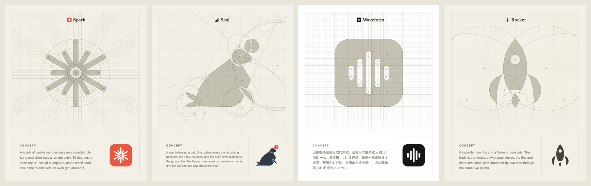
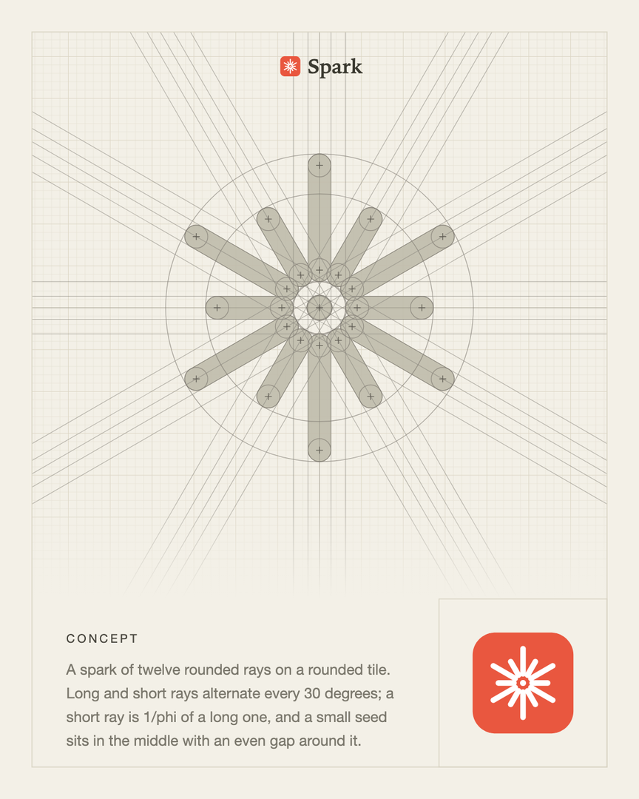
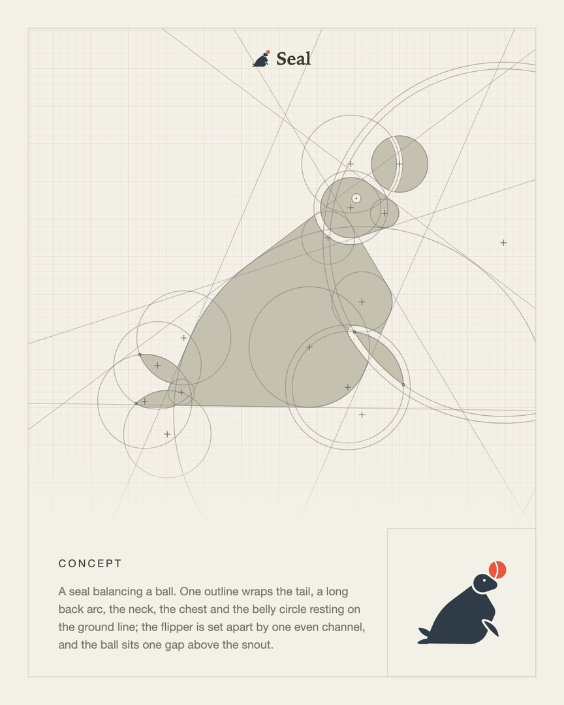
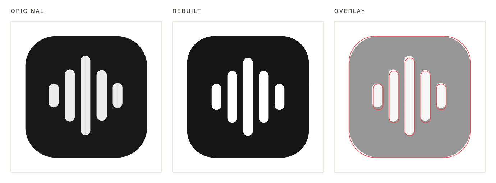
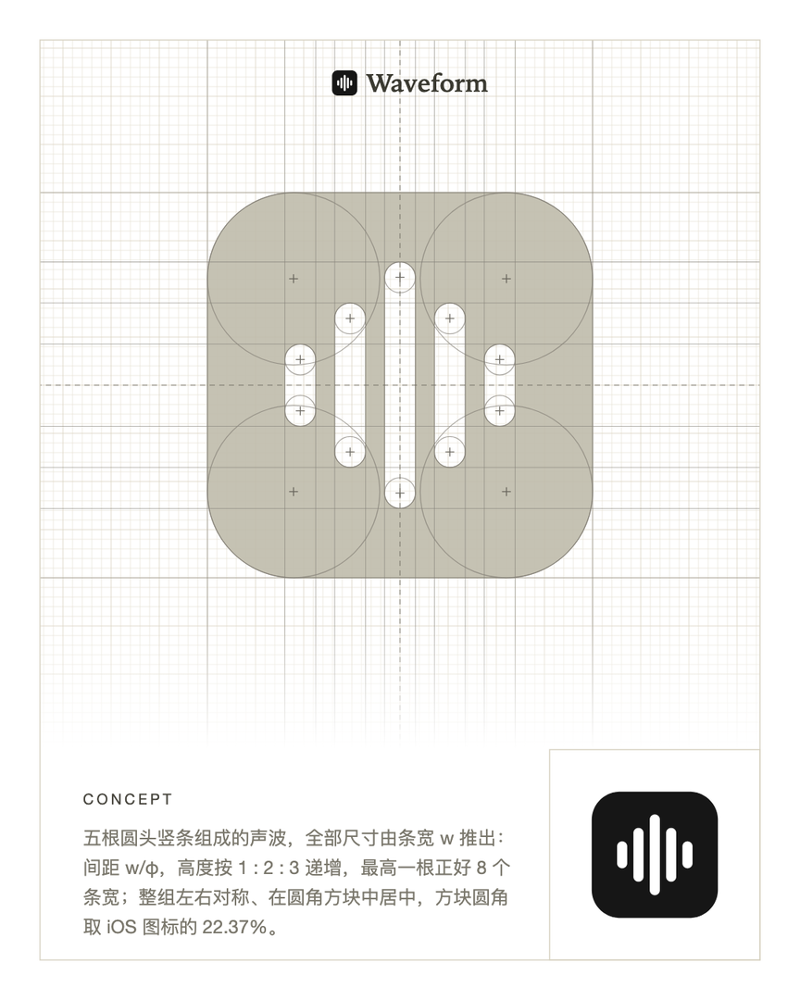
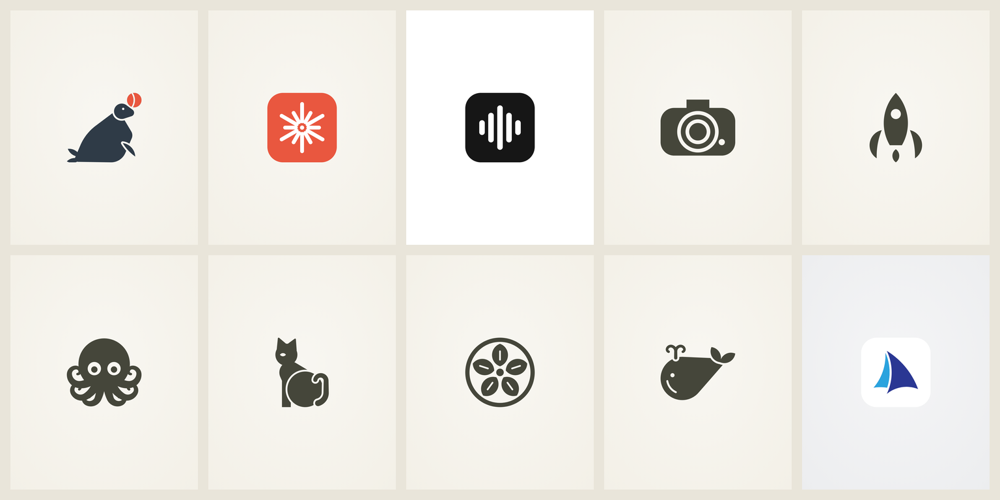
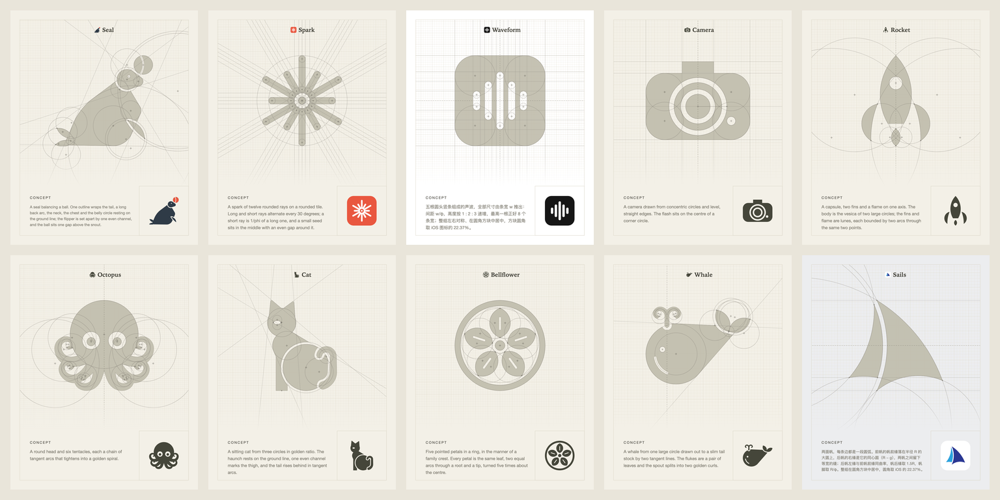

# geo-icon

**一个 agent skill：用几何构造（圆、圆弧、切线、等宽缝）生成图标和 logo，并输出构图证明卡。**

[English](README.md)



agent 写的是**构造**：一份很短的 JSON 规格，描述圆、环、叶形、相切圆弧链和布尔运算。脚本据此算出轮廓，
再把同一批图元画回构图卡上作为构造线。所以卡上的几何就是形状的来源，而不是事后贴上去的装饰。

```bash
npx skills add wyh0626/geo-icon
```

## 功能

### 1. 用几何生成新图标

描述你想要的东西，比如"圆角方块上的极简几何火花图标"。agent 会挑选图元，定一套比例系统
（一个模数，半径成族，如 R、R/φ、R/φ²），然后写出规格。一次运行得到：

| 文件 | 内容 |
|---|---|
| `icon.svg` / `icon.png` | 成品。沿构造圆的轮廓写成真正的 SVG 圆弧 `A`，直段写成 `L` |
| `construction.png` | 构图卡：方格纸、落在最终轮廓上的圆和切线、圆心十字、概念文案、缩略图 |
| `poster.png` | 4:5 画布上居中的成品 |
| `sizes.png` | 128→16px 正反色小尺寸测试 |
| `report.txt` | 体检：精确圆弧占比、半径种类、过细部位、会糊的窄缝、孤立碎片 |

<p align="center"> </p>

*Spark：十二根胶囊形光芒，长短每 30° 交替，短的是长的 1/φ（[规格](skills/geo-icon/examples/spark.json)）。*

<p align="center"> </p>

*Seal：一条轮廓依次绕过尾巴、一段长背弧（r = 50）、颈、胸和贴在地面线上的腹圆；鳍和头用同一宽度的缝分层，
球在鼻尖上方一个缝宽处，单独上色（[规格](skills/geo-icon/examples/seal.json)）。*

### 2. 规整现有图标

给一张图标图片。`measure.py` 会报出每个部件的宽度、间距、高度比和居中偏差，由此读出图标原本想表达的比例
（等宽？1:2:3？整组居中？）。agent 在精确的网格上重建它，输出"原图 | 规整后 | 叠加"三联对比，
以及说明结果的构图卡。



<p align="center"></p>

*五根圆头竖条，所有尺寸由条宽 w 推出：间距 w + w/φ，高度 1 : 2 : 3，最高一根为 8w；方块圆角取 iOS 的 22.37%
（[规格](skills/geo-icon/examples/waveform.json)）。*

### 3. 其他

- **图元：** 圆、环、椭圆、圆角矩形、多边形、扇形、`lune`（两条弧穿过同样两点：叶、鳍、鱼形）、
  `arcgon`（每条边是圆弧的多边形，边可以钉在某个圆上）、`chain`（绕圆的皮带轮廓）、`hull`、渐细描边、
  `turtle`（相切圆弧链和黄金螺旋）、布尔运算、镜像、旋转、阵列。
- **等宽缝：** `{"add": X, "gap": g}` 在重叠部件之间挖出统一宽度的缝，构图卡上画成同心圆。
- **多色和 App 图标：** `backdrop`（如圆角方块底）和 `paint`（分区上色）；`--icon-pad 0 --icon-png 1024` 输出满版 App Store 图标。
- **评审外部 SVG：** `geoicon.py --svg 文件.svg` 对别处生成的 SVG 做海报、小尺寸测试和体检。
- **复杂题材的预留接口：** 龙、麒麟这类细节繁多的题材无法用几个圆概括。`scripts/external.py` 是接入自由矢量模型的接口，
  本项目不内置任何第三方服务。





## 安装

用 [skills CLI](https://skills.sh)：

```bash
npx skills add wyh0626/geo-icon            # 安装到当前项目
npx skills add wyh0626/geo-icon -g         # 所有项目可用
```

或者把 `skills/geo-icon` 复制到 `~/.claude/skills/`（Claude Code），或你所用 agent 的 skills 目录。

依赖 Python 3.9+：

```bash
python3 -m pip install -r skills/geo-icon/requirements.txt   # shapely>=2、numpy、Pillow
```

PNG 输出依次尝试 `rsvg-convert`、`cairosvg`、Chrome/Chromium/Edge 无头模式、macOS `qlmanage`；都没有时只输出 SVG。

## 用法

直接对 agent 说，例如：

- "给面包店设计一个极简几何 logo，用圆构成一个面包。"
- "做一个几何风格的猫头鹰图标，给我看构图卡。"
- "把我的 App 图标（icon.png）规整一下：等宽、居中、iOS 圆角。"

也可以直接运行脚本：

```bash
python3 skills/geo-icon/scripts/geoicon.py skills/geo-icon/examples/spark.json -o out/spark
python3 skills/geo-icon/scripts/measure.py my-icon.png
python3 skills/geo-icon/scripts/geoicon.py spec.json -o out --compare my-icon.png --icon-pad 0 --icon-png 1024
```

完整的规格语法见 [`references/spec.md`](skills/geo-icon/references/spec.md)，构造方法和经验总结见
[`references/method.md`](skills/geo-icon/references/method.md)。

## 致谢

构图卡的思路和视觉风格参考了 [Rikyū](https://rikyu.ai) 的几何 logo 功能。本项目独立实现，与 Rikyū 没有关联：
从零重写了这套通用方法，即形状由圆和直线算出，再把构造画回方格纸构图卡。

仓库中的示例图标均为原创设计。

## 许可证

[MIT](LICENSE)
